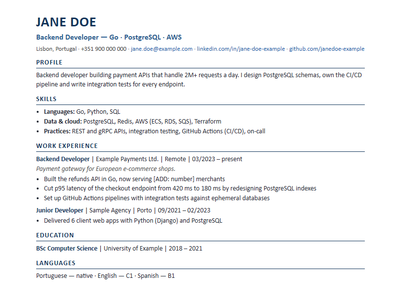

# Hiring Panel: a Claude Code skill for CVs

Get your CV reviewed by **a panel of AI reviewers**: an ATS screen and five personas who each judge it blind. They then **debate each other's findings** and the CV gets rewritten. The loop repeats until the panel signs off.

You can bring an existing CV, your LinkedIn PDF, your GitHub profile, or any mix of them. You choose the output languages (English, Czech, German, …), and you get **one CV per language with identical content**, each as Markdown, HTML and PDF.

<p align="center"></p>

## The panel

| Reviewer | Reads your CV as… |
|---|---|
| 🤖 **ATS** | The applicant-tracking system: can it parse the CV, and does it match the role's keywords? Returns PASS or REJECT. |
| 👔 **CEO** | Does this person move the business? Looks for impact, ownership and seniority. |
| ⏱️ **Recruiter with 30 seconds** | What sticks in 6 seconds? Red flags, gaps, length, links that work. |
| 🥊 **Another applicant** | Where would I beat this CV? Flags what is generic, unproven or padded. |
| 🧑‍💼 **Hiring manager** | Can they do the job from day one? Looks for depth, not buzzwords. |
| 🧑‍💻 **Future teammate** | Would the claims survive a 10-minute technical chat? Watches for overclaiming. |

## How a run works

```
Intake ─► Facts ─► ┌── Round N ─────────────────────────────────────────────────┐ ─► Final
                   │  ATS + 5 blind reviews (parallel)                          │    MD / HTML / PDF
                   │      ─► Debate: each reviewer reads all others (parallel)  │    per language
                   │      ─► Moderator verdict: ranked fixes, disputes settled  │    + REPORT.md
                   │      ─► Rewrite every language from one structure          │
                   │      ─► Parity check across languages                      │
                   └── repeat until everyone scores ≥ 8/10 and ATS passes (max 3) ┘
```

1. **Intake.** The skill asks what you have (CVs, LinkedIn PDF, GitHub), which languages you want and what role you're targeting. A job posting is optional.
2. **Facts.** It pulls your sources together into one `facts.md`. Your GitHub profile, its repos and READMEs, and any store or portfolio links found there are fetched through public pages. It flags conflicts, such as different dates in different sources, a broken LinkedIn URL, or a project on GitHub that your CV never mentions.
3. **Fact interview.** It asks you up to 4 short questions about the gaps reviewers will hunt for, such as scale, testing or release ownership. You decide what goes in. **Nothing is ever invented.** Unknown numbers become `[ADD: …]` placeholders you fill in.
4. **Rounds.** These are the review → debate → verdict → rewrite loop shown above.
5. **Output.**
   - `final/CV_<Name>_<LANG>.pdf` (plus `.html` and `.md`)
   - `REPORT.md` with every score, the debate outcomes, the list of changes and the open questions

Your original files are never modified.

## Install

**As a plugin (recommended).** In Claude Code, run these **one at a time**. Pasting both lines together merges them into one invalid command.

1. Add the marketplace:
   ```
   /plugin marketplace add pikacu100/hiring-panel
   ```
2. Install the plugin:
   ```
   /plugin install hiring-panel@hiring-panel
   ```

Or install from your terminal:

```bash
claude plugin marketplace add pikacu100/hiring-panel
claude plugin install hiring-panel@hiring-panel
```

Restart Claude Code afterwards so the skill is loaded.

**Manually.** Copy the skill folder into your personal skills directory:

```bash
git clone https://github.com/pikacu100/hiring-panel
cp -r hiring-panel/skills/hiring-panel ~/.claude/skills/
```

On Windows (PowerShell):

```powershell
git clone https://github.com/pikacu100/hiring-panel
Copy-Item -Recurse hiring-panel\skills\hiring-panel $HOME\.claude\skills\
```

### Requirements
- [Claude Code](https://claude.com/claude-code)
- Python 3.8+ for the HTML renderer (standard library only)
- Google Chrome, Chromium or Microsoft Edge for PDF export (optional; without one you get HTML and print it yourself)

## Usage

```
/hiring-panel
```

Or describe what you want:

```
/hiring-panel my CVs are in ~/Documents/cv, I want English and German, target role: senior Android developer
```

```
/hiring-panel no CV yet — build it from my LinkedIn export ~/Downloads/Profile.pdf and github.com/<username>, in English
```

```
/hiring-panel review ./resume.pdf against this posting: https://example.com/jobs/123
```

**About LinkedIn:** linkedin.com blocks automated access. Open your profile, click **More → Save to PDF**, and give the skill that file.

## Cost and time

One full round runs **11 subagents**: 1 ATS screen, 5 reviews and 5 debate responses. A typical run takes 2–3 rounds, and later rounds can use a lighter sign-off check. Expect roughly 15–30 minutes and a noticeable amount of tokens. That's the price of five independent opinions plus a debate.

## Privacy

Everything runs locally in your Claude Code session. The skill only fetches public pages you point it to, such as your GitHub profile or a store listing. It never submits your data to forms or third-party services. Working files go to a `.hiring-panel/` folder next to your CV, which is git-ignored in this repo, so keep it out of any public repo of your own too.

## Repository layout

```
.claude-plugin/
  plugin.json             plugin manifest
  marketplace.json        lets `/plugin marketplace add` find it
skills/hiring-panel/
  SKILL.md                the workflow Claude follows
  references/prompts.md   prompt templates for the ATS, reviewer, debate and sign-off subagents
  scripts/cv2html.py      Markdown → single-column, ATS-friendly A4 HTML
examples/
  example_cv_en.md        a fictional CV showing the Markdown format
  example_cv_en.pdf       the rendered result
```

## Contributing

Issues and PRs are welcome. Useful contributions include:
- new personas for specific industries
- better market-specific CV conventions
- more output templates

## License

[MIT](LICENSE) © Michal Sedlák
